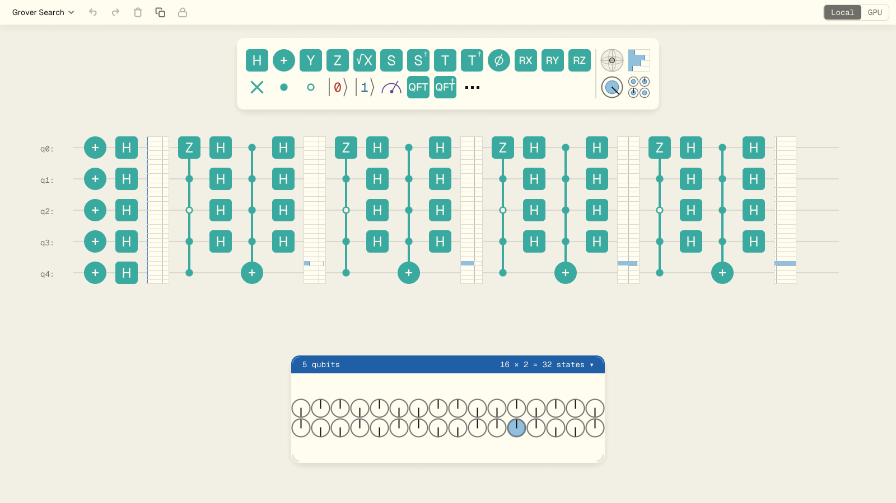
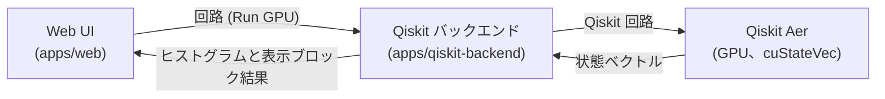

[English](README.md) | 日本語

# qni-webgpu

ブラウザ上で動く **WebGPU ベースの量子回路エディタ兼シミュレーション環境**です。
Rust と egui で書いた回路エディタを WebAssembly として配信し、状態ベクトルや表示ブロックの計算を WebGPU compute shader 上で行います。

[Qni](https://github.com/qniapp/qni) (WebGL ベースの qni-gl) の正式な後継プロジェクトで、状態シミュレーションを **GPU 上で完結させる構成** に刷新しています。



> 画面例: サンプル回路の Grover 探索です。状態ベクトル表示で、解の確率振幅だけが大きくなる様子が確認できます。

## 機能

- **Web UI 上での量子回路編集** — ゲートパレットからドラッグしてゲートを配置できます。扱える量子ビット数はローカルの WebGPU シミュレーションで最大 16 量子ビット、外部 GPU (Qiskit) バックエンド利用時は最大 32 量子ビットです。
- **WebGPU による高速なローカルシミュレーション** — 状態ベクトル、密度行列、ブロッホベクトルなどの計算と表示を GPU 上で行います。本番の描画経路では GPU から CPU へのリードバックを行いません (テスト専用のオンデマンド読み出しは除きます)。
- **表示ブロック** — 振幅、確率、ブロッホ球、密度行列の各表示ブロックに対応しています。
- **外部 GPU 実行 (Qiskit バックエンド、任意)** — `Run GPU` から `apps/qiskit-backend` の HTTP API に送り、Qiskit Aer (cuStateVec) で実行できます。
- **ABCI と Open OnDemand への配備の土台** — Docker、Singularity、Open OnDemand 用の定義を `deploy/` に同梱しています。

## クイックスタート

ローカルで Web UI を起動する最短手順です。Rust (stable)、Node.js 22.18 以降、pnpm 9 が必要です。

### 1. Rust と Trunk を用意する

```bash
rustup target add wasm32-unknown-unknown
cargo install trunk --locked
```

### 2. 開発サーバを起動する

```bash
cd apps/web
pnpm install
trunk serve --address 127.0.0.1 --port 4174 --no-autoreload
```

### 3. ブラウザで開く

WebGPU 対応ブラウザ (Chrome または Chromium 系の最新版を推奨) で次を開きます。

```text
http://127.0.0.1:4174/
```

リポジトリルートで `./scripts/open-web.sh` を実行すると、起動済みの Web UI が開きます。ブラウザは `google-chrome-stable` が優先されます。

詳しい起動方法と環境変数は [`docs/web.md`](docs/web.md) を参照してください。

## 開発

主要なチェックは、リポジトリルートで次のコマンドを使ってまとめて実行できます。

```bash
./scripts/check-all.sh
```

これは Web の Rust fmt、clippy、test、snapshot チェックと Trunk 本番ビルド、Web の事前チェック、BDD、Playwright テスト、Node の配備設定テスト、Qiskit バックエンドのインストール確認とテスト、TUI の fmt、clippy、test、snapshot、audit、deny を実行します。ドキュメント lint は含まれません。クイックスタートの前提条件に加え、`cargo-insta`、`cargo-audit`、`cargo-deny`、Playwright 用 Chromium と Xvfb、Python 3.10 以降が必要です。

個別に実行する場合の主なコマンドは次のとおりです。

- **Web の BDD (Cucumber)**: `cd apps/web && pnpm install && pnpm run test:bdd` を実行します。
- **Web の Playwright**: `cd apps/web && pnpm exec playwright install chromium && xvfb-run -a -s "-screen 0 1920x1080x24" pnpm exec playwright test` を実行します (`xvfb-run` のため Xvfb が必要です)。
- **ドキュメント lint**: `./scripts/lint-docs.sh` で用語ゆれ、HTML 構造、Markdown スタイルを確認します。

詳細は [`docs/rust.md`](docs/rust.md) と [`docs/web.md`](docs/web.md) を参照してください。

## Qiskit バックエンド (任意)

`Run GPU` から呼び出す外部 GPU 実行用のローカルバックエンドです。Web UI は回路を送り、バックエンドはヒストグラムと表示ブロック単位の結果だけを返します。全状態ベクトルや全確率分布は転送しません。



ローカルで起動する最短手順は次のとおりです (Python 3.10 以降が必要です)。

```bash
PYTHONPATH=apps/qiskit-backend/src python3 -m qni_qiskit_backend --port 4184 --runner mock
```

ランナーは 3 種類あります。

- `mock` — 固定のヒストグラムと表示ブロック結果を返します。UI と API のスモークテストに使います。
- `qiskit-cpu-dev` — Qiskit 経路を CPU で確認するための **明示的な開発用ランナー**です。WebGPU の CPU フォールバックではありません。
- `qiskit-gpu` — `device="GPU"` と `cuStateVec_enable=True` を要求する本番相当のランナーです。CPU にはフォールバックしません。

本番配備では `qiskit-gpu` だけを許可し、`mock` または `qiskit-cpu-dev` を要求するリクエストは拒否します。外部バックエンドは最大 32 量子ビットに対応しますが、振幅表示の厳密な抽出は 16 量子ビット以下に限られます。詳細は [`apps/qiskit-backend/README.md`](apps/qiskit-backend/README.md) を参照してください。

## 配備

ABCI の GPU ノードで動かすための Docker、Singularity、Open OnDemand 定義を `deploy/` に同梱しています。Open OnDemand 経由では `singularity run --nv` で GPU ノード上に起動し、`/node/<host>/<port>/` 配下で Web UI と `/run` API を提供します。

```bash
docker build -t qni-webgpu-abci .
docker run --gpus all --rm -p 8000:8000 \
  -e QNI_AUTH_USERNAME=userA \
  -e QNI_AUTH_PASSWORD=passA \
  qni-webgpu-abci
```

この例では Basic 認証を設定しています。コンテナは認証情報が未設定でも起動するため、公開環境では認証を設定してください (`QNI_REQUIRE_BASIC_AUTH=true` を指定すると認証情報なしの起動を拒否できます)。

配備の詳細は次を参照してください。

- [`docs/implementation/abci-deployment-guide.md`](docs/implementation/abci-deployment-guide.md) — ABCI Open OnDemand の配備手順です。
- [`docs/implementation/external-gpu-api-compatibility.md`](docs/implementation/external-gpu-api-compatibility.md) — 外部 GPU API の互換方針です。
- [`docs/implementation/qni-gl-migration-notes.md`](docs/implementation/qni-gl-migration-notes.md) — qni-gl との差分です。

## ドキュメント

- [`docs/architecture.md`](docs/architecture.md) — WebGPU 版のアーキテクチャの概要です。
- [`docs/tech-stack.md`](docs/tech-stack.md) — 技術スタック (Rust、wgpu、egui、Trunk) です。
- [`docs/web.md`](docs/web.md) — Web アプリの起動・確認手順です。
- [`docs/rust.md`](docs/rust.md) — Rust 側のチェック手順です。
- [`docs/design.md`](docs/design.md) — UI 設計メモです。
- [`apps/qiskit-backend/README.md`](apps/qiskit-backend/README.md) — Qiskit バックエンドの API 仕様です。

## 既知の制限

- **WebGPU 対応ブラウザが必要**: 主要ブラウザの最新版 (Chrome、Edge、Firefox、Safari) で動作します。ただし Firefox の Linux 安定版は WebGPU 未対応で、Nightly または Beta で `gfx.webgpu.ignore-blocklist` を有効にする必要があります (2026 年 5 月時点)。WebGPU に対応していない GPU やドライバでは起動しません。
- **Qiskit バックエンドは別途用意**: `Run GPU` を使うには `apps/qiskit-backend` を別プロセスで起動する必要があります。本番 `qiskit-gpu` ランナーは CUDA と cuStateVec を要求します。
- **ABCI 配備は環境依存**: `deploy/` 配下の定義は ABCI 実機では一部しか検証しておらず、資源の種別やモジュール名は環境に合わせて調整する必要があります。
